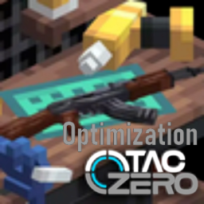

# Optimization for Tacz

An all-in-one **optimization and quality-of-life add-on** for
[Timeless and Classics Zero (TaCZ)](https://modrinth.com/mod/tacz).

It only changes how things look and feel. It does **not** add attachment slots, does
**not** add items, and does **not** write into your gun packs.

<p align="center">
  
</p>

<p align="center">
  <a href="https://github.com/pyxyd/Optimization-mod"></a>
  <a href="https://modrinth.com/mod/optimization-forge"></a>
  
  
  
</p>

---

## Features

| # | Feature | What it does |
|---|---------|--------------|
| 1 | **Custom bullet holes** | The hole left in a block uses your own texture instead of the vanilla one, floating one layer above it, then fades out. |
| 2 | **One-shot kill** | Guns you list kill any non-player mob on hit. Players are never affected unless you enable it. |
| 3 | **Hybrid aim** | Tap the aim key to toggle aiming, hold it to aim only while held. Mouse and keyboard both work. |
| 4 | **Auto aim before fire** | Holding fire aims first and shoots only once the scope is up, so the shot never leaves the barrel unscoped. Per-gun on/off panel in game (default key `O`). |
| 5 | **Hit marker** | One X flashes next to the crosshair: **white** = body, **orange** = headshot, **red** = that shot killed. The shape never changes, only the colour. |
| 6 | **Hip-fire crosshair** | A Delta-Force style hollow cross whose gap follows the real TaCZ hip-fire inaccuracy of the gun in your hands. Hidden while aiming. |
| 7 | **Crouch-aim, recoil only** | While crouching **and** fully scoped in, bullet spread is forced to zero. Recoil, sound and damage are untouched. |
| 8 | **Gun knockback** | Every gun's `bullet.knockback` is set to `1`, so hits actually shove the target. |

Everything is toggled from a single config file: **`config/taczopt.properties`**.
It hot-reloads within a second -- no restart needed. Gun pack data is different: it is
read only at game startup, so changes there need a full restart.

---

## Requirements

| | |
|---|---|
| Minecraft | 1.20.1 |
| Forge | 47.4.26 (any 47.x should work) |
| TaCZ | 1.1.8 or newer |

---

## Install

1. Install Forge 47.x for Minecraft 1.20.1.
2. Drop [TaCZ](https://modrinth.com/mod/tacz) into `mods/`.
3. Drop `Optimization-for-Tacz-<version>-forge.jar` into `mods/`.
4. Start the game once -- `config/taczopt.properties` is created with comments
   explaining every option.

---

## Build from source

Windows only, and it needs a **JDK 17** plus a working Minecraft 1.20.1 / Forge 47.4.26
installation (the build compiles against the real Forge and TaCZ jars).

```powershell
git clone https://github.com/pyxyd/Optimization-mod.git
cd Optimization-mod
powershell -ExecutionPolicy Bypass -File .\build.ps1
```

`build.ps1` guesses the game folder as the sibling directory of this repository. Point it
somewhere else with:

```powershell
powershell -ExecutionPolicy Bypass -File .\build.ps1 -GameDir "D:\pcl2\.minecraft\versions\1.20.1-Forge_47.4.26"
```

The finished jar is written into that game folder's `mods\`.

### What the build refuses to skip

`build.ps1` will not produce a jar unless all of these pass. Every one of them exists
because that specific mistake actually happened and shipped once:

| Check | Catches |
|---|---|
| `ModsTomlCheck` | parses `mods.toml` with the same library Forge uses, so a corrupt toml cannot reach the game |
| `MixinsCheck` | a `@Mixin` class that is not listed in the mixins json (crashes the game the first time that code path runs) |
| `InjectionCheck` | a mixin target that no longer exists, or **arguments in the wrong order** -- it walks TaCZ's bytecode with ASM and derives which parameter feeds each argument instead of trusting parameter names |
| `CrosshairCheck` | crosshair geometry, spread mapping, stance priority |
| `ConfigUpgradeCheck` | legacy config values get upgraded, dead keys get removed |
| `HitFeedbackCheck` | hit-marker geometry and the white / orange / red colour rules |

### Packaging a source zip

```powershell
powershell -ExecutionPolicy Bypass -File .\tests\make_source_zip.ps1
```

Writes `Optimization-for-Tacz-<version>-src.zip` next to the repository. It refuses to
write an archive that contains build output, uses backslash entry names, or has lost the
mod icon.

---

## Repository layout

```
build.ps1                    build + verify + package the mod
src/
  com/taczopt/               Java sources
    adsfire/                 auto aim before fire (+ the in-game panel)
    bullethole/              custom bullet hole texture
    config/                  the shared config file reader/writer
    crosshair/               hip-fire crosshair and the TaCZ spread algorithm
    hitfeedback/             the hit marker
    hybridaim/               tap / hold aiming
    mixin/                   the Mixins into TaCZ and vanilla
    oneshot/                 one-shot kill
    util/                    small shared helpers
  resources/                 mods.toml, pack.mcmeta, mixins json, assets, icon
tests/                       build-time checkers and the packaging script
docs/                        user guide and developer notes
```

---

## Credits and licence

TaCZ is a separate project by its own authors. This is an **unofficial** add-on, not
affiliated with or endorsed by the TaCZ team, and it contains no TaCZ code.

The mod icon is based on TaCZ's own logo, with the author's artwork and text on top; the
TaCZ word mark remains the property of the TaCZ project.

**All Rights Reserved** -- free to use and to make videos with, but please do not
reupload, modify and republish, or bundle it into a distributed modpack without asking.
See [LICENSE](LICENSE) for the exact terms.
